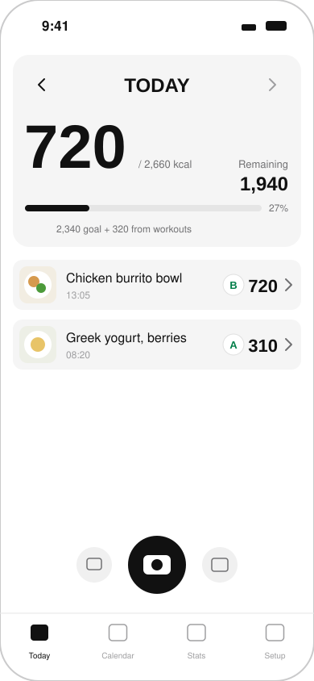
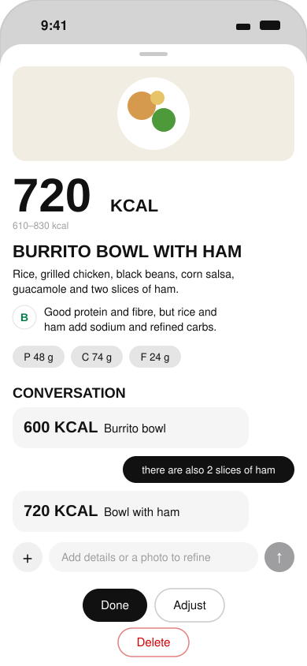
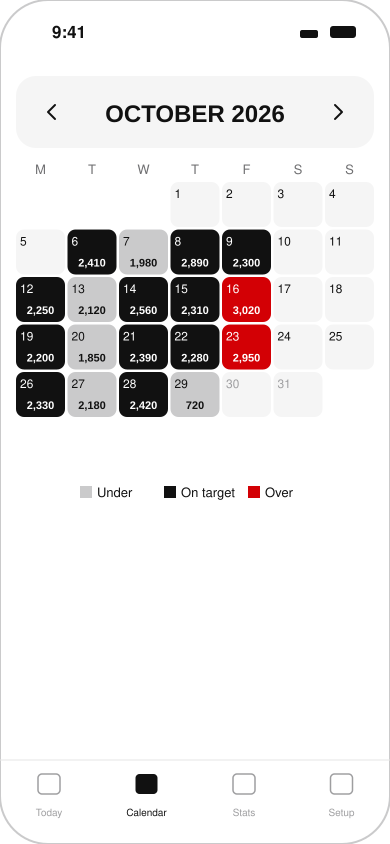
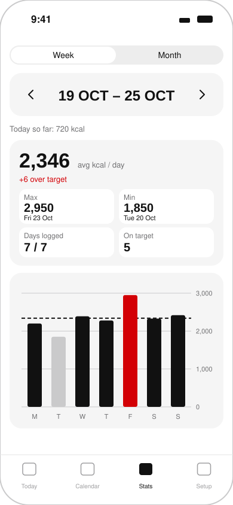
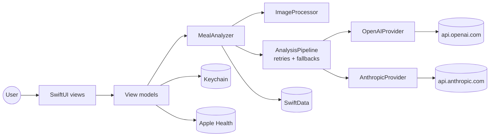

# Snap Kcal

**Snap a photo of your meal, get calories in seconds.** A minimal iPhone calorie tracker powered by your own OpenAI or Anthropic API key, with no account, no backend and no subscription.

   

<p align="center">
  
  
  
  
</p>
<p align="center"><sub>Mockups of the Today, Meal result, Calendar and Stats screens.</sub></p>

## Why

Most calorie trackers make you search food databases and weigh grams. Snap Kcal flips that: point the camera at the plate, tap once, and a vision model returns an estimate with a range, macros and a health score. Correct it in plain language ("there are also 2 slices of ham") and the estimate updates. Everything stays on your phone except the photo sent to the provider you choose.

## Features

- **Photo to logged meal in two taps.** Camera, photo library or text-only entries.
- **Conversational refinement.** Follow up with text or another photo; each turn re-estimates the meal.
- **Kcal range, macros and health score** (1 to 10, shown as an A to E grade) with a short reason and tip.
- **Packaged food handling.** Nutrition labels are read as ground truth; branded products trigger the provider's web search for official values.
- **Bring your own model.** OpenAI or Anthropic, with live model lists, a "test model" check and automatic fallbacks for models that lack JSON schema, reasoning effort or web search.
- **Personal targets.** BMR/TDEE from weight, height, age, sex and activity, with lose / maintain / gain goals.
- **Apple Health workouts.** Optionally adds active calories from today's workouts to the daily goal.
- **Calendar and stats.** Month heatmap (under / on target / over) and week or month averages, max, min and days on target.
- **Export.** JSON and CSV of all meals via the share sheet.
- **Private by design.** Keys in the Keychain, data in SwiftData on device, no analytics, no third-party SDKs.

## Architecture



The full layer diagram, the analysis sequence and the key-handling flow are in [docs/architecture.md](docs/architecture.md).

## Tech stack

| Area | Technology |
| --- | --- |
| Language | Swift 6 (strict concurrency) |
| UI | SwiftUI, Swift Charts |
| Persistence | SwiftData, Keychain, UserDefaults |
| Health | HealthKit (active energy from workouts) |
| Networking | `URLSession` async/await, no SDKs |
| AI | OpenAI Responses API, Anthropic Messages API |
| Project | XcodeGen (`project.yml`), Make |
| Tests | Swift Testing, XCUITest |

## Getting started

### Prerequisites

- macOS with **Xcode 26** or newer (iOS 18 SDK or later)
- [XcodeGen](https://github.com/yonaskolb/XcodeGen): `brew install xcodegen`
- An **OpenAI** and/or **Anthropic** API key
- For a real device: an Apple ID added in Xcode (a free Personal Team works)

### Install

```bash
git clone https://github.com/michalilski/snap-kcal.git
cd snap-kcal
make setup
```

`make setup` creates `.env` and `Config/Signing.local.xcconfig` from their templates and generates `SnapKcal.xcodeproj`.

### Configure

1. **Signing** (only for device builds). Edit `Config/Signing.local.xcconfig`:

   ```
   DEVELOPMENT_TEAM = YOUR_TEAM_ID
   BUNDLE_ID_PREFIX = com.yourname
   ```

   Find your team ID in Xcode > Settings > Accounts. A unique bundle prefix is required with a free team.

2. **API keys** (optional). Either paste keys in the app's **SETUP** tab, or fill `.env` for personal builds:

   ```
   OPENAI_API_KEY=
   ANTHROPIC_API_KEY=
   OPENAI_MODEL=
   ANTHROPIC_MODEL=
   ```

   A post-build script copies these into the app bundle and the app moves them to the Keychain on first launch. Never share a build made with a filled `.env`.

### Run

| Command | What it does |
| --- | --- |
| `make build` | Build for the iOS Simulator |
| `make test` | Run unit tests on the simulator |
| `make ui-test` | Run UI tests on the simulator |
| `make device` | Signed Release build for a physical iPhone |
| `make install DEVICE=<id>` | Install the Release build with `devicectl` |
| `make clean` | Remove `build/` |

Override the simulator with `make test SIMULATOR="iPhone 17"`. You can also open `SnapKcal.xcodeproj` in Xcode and run the **SnapKcal** scheme, or **SnapKcal-Mock** to try the app with canned AI responses and no API key.

### Sideloading with a free Apple ID

Apps signed with a free Personal Team expire after **7 days**. To reinstall:

```bash
make device
xcrun devicectl list devices
make install DEVICE=<your-device-id>
```

If the app refuses to launch with "profile has not been explicitly trusted", go to **Settings > General > VPN & Device Management** on the iPhone and trust your developer certificate. App data survives reinstalls as long as the bundle ID stays the same.

## Project structure

```
snap-kcal/
├── SnapKcal/
│   ├── App/                 App entry, environment wiring, tab view
│   ├── Design/              Theme tokens and reusable components
│   ├── Features/            Today, Capture, MealDetail, Calendar, Stats, Settings, Onboarding
│   ├── Models/              SwiftData models, settings, enums
│   ├── Services/            Image processing, nutrition and stats math, Keychain, HealthKit, export
│   │   └── AI/              Providers, prompt, schema, pipeline, mock
│   └── Resources/           Info.plist, entitlements, assets
├── SnapKcalTests/           Unit tests and JSON fixtures
├── SnapKcalUITests/         Smoke test and screenshot tour
├── Config/                  Signing xcconfig and local template
├── Scripts/                 Build-time .env embedding, icon generator
├── docs/                    Architecture, build plan, changelog, mockups
├── project.yml              XcodeGen project spec
└── Makefile                 Setup, build, test and device targets
```

## Configuration

| Setting | Where | Notes |
| --- | --- | --- |
| `DEVELOPMENT_TEAM` | `Config/Signing.local.xcconfig` | Gitignored, needed for device builds |
| `BUNDLE_ID_PREFIX` | `Config/Signing.local.xcconfig` | Defaults to `com.michalilski` |
| `OPENAI_API_KEY`, `ANTHROPIC_API_KEY` | `.env` or SETUP tab | Stored in the Keychain on device |
| `OPENAI_MODEL`, `ANTHROPIC_MODEL` | `.env` or SETUP tab | Optional, otherwise a fast model is auto-picked |
| Analysis detail | SETUP tab | Fast or Accurate |
| Workout calories | SETUP tab | Requires Apple Health permission |
| `-mockAI` launch argument | `SnapKcal-Mock` scheme | Offline canned responses |

## Screenshots

The UI test `ScreenshotTour` captures every main screen from the simulator using mock data:

```bash
TEST_RUNNER_SCREENSHOT_DIR=/path/to/output xcodebuild test -scheme SnapKcal \
  -destination 'platform=iOS Simulator,name=iPhone 17 Pro' \
  -only-testing:SnapKcalUITests/ScreenshotTour
```

## Disclaimer

Calorie and nutrition values are AI estimates, not medical advice. Photos are sent only to the AI provider you configure and are subject to its data policy.

## License

[MIT](LICENSE) © 2026 Michał Ilski
