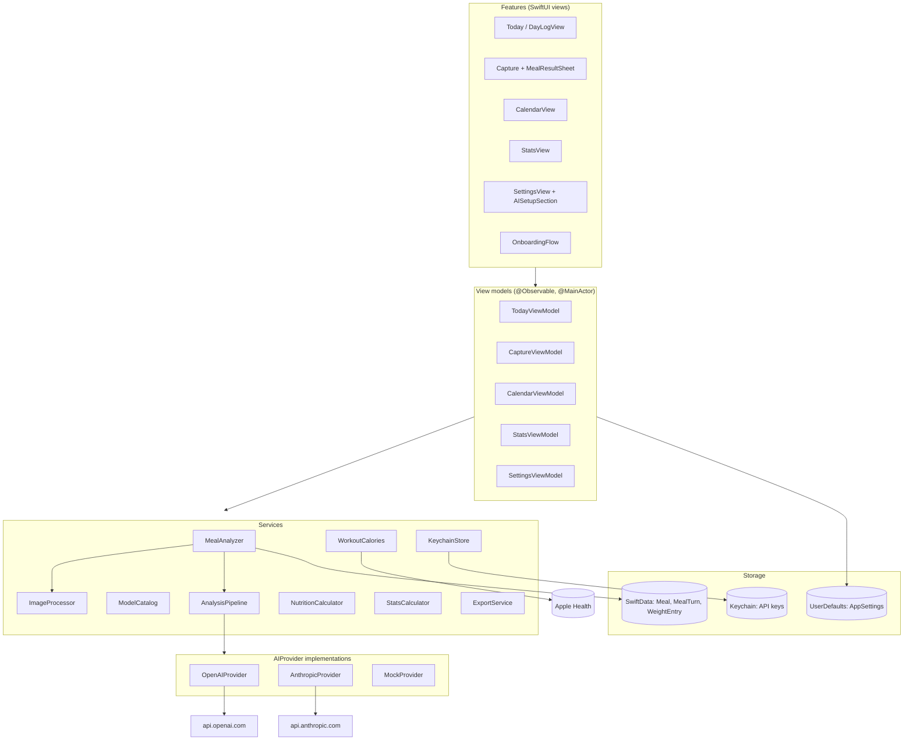
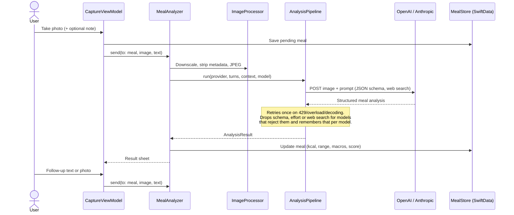
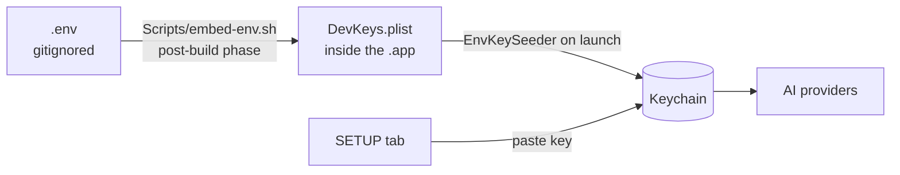

# Architecture

Snap Kcal is a single-target SwiftUI app with no backend and no third-party dependencies. Everything lives on the device; the only network traffic is the request to the AI provider the user picked.

## Layers

`AppEnvironment` wires everything together at launch and swaps in `MockProvider` and `MockActivitySource` when the app runs with `-mockAI` (the `SnapKcal-Mock` scheme and UI tests).

## Meal analysis flow

## Key decisions

| Concern | Choice |
| --- | --- |
| UI | SwiftUI, iOS 18+, Swift 6 strict concurrency |
| State | `@Observable` view models on the main actor |
| Persistence | SwiftData, photos stored with external storage |
| Secrets | Keychain (`AfterFirstUnlockThisDeviceOnly`), never UserDefaults |
| Networking | `URLSession` async/await with hand-written DTOs, no SDKs |
| Structured output | JSON schema (`MealSchema`) with prompt-only fallback |
| Packaged food | Provider web search tool, nutrition labels read as ground truth |
| Workouts | HealthKit active energy from workouts added to the daily goal |
| Project file | Generated by XcodeGen from `project.yml` |
| Tests | Swift Testing for logic, XCUITest smoke test and screenshot tour |

## API keys at build time

Keys from `.env` are a convenience for personal sideloaded builds. They end up inside the app bundle, so never distribute a build made with a filled `.env`; enter keys in the SETUP tab instead.

See [build-plan.md](build-plan.md) for the original product plan and [changelog.md](changelog.md) for what changed since.
